# Verrian — Il guardiano del codice

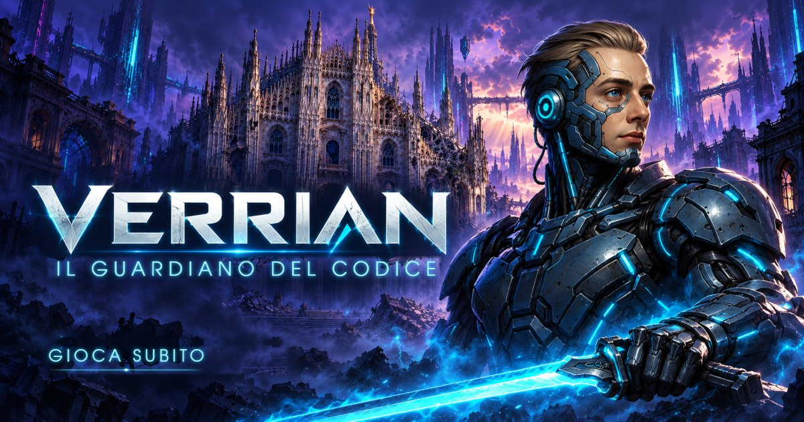

Avventura arcade 2D per il browser, nata nel laboratorio di informatica dell’I.I.S.S. Pietro Verri di Milano. Nell’anno 2148, Verrian, un cyborg custode del codice, cerca di salvare l’umanità dall’avvento scellerato dell’intelligenza artificiale. Attraversa quattro mondi digitali, a partire dalle rovine di Milano: riattiva i nodi, sconfigge i bug e affronta un boss alla fine di ogni mondo.

**Gioca subito:** https://verrian.verri.edu.it/ (gratis, senza account)

[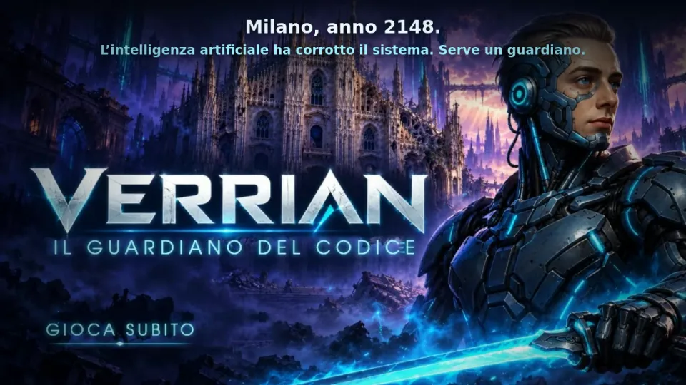](https://verrian.verri.edu.it/assets/verrian/video/verrian-trailer-v2.webm)

*Clicca sull’immagine per vedere il trailer (WebM, 62 s).*

## Immagini

| | |
| --- | --- |
| 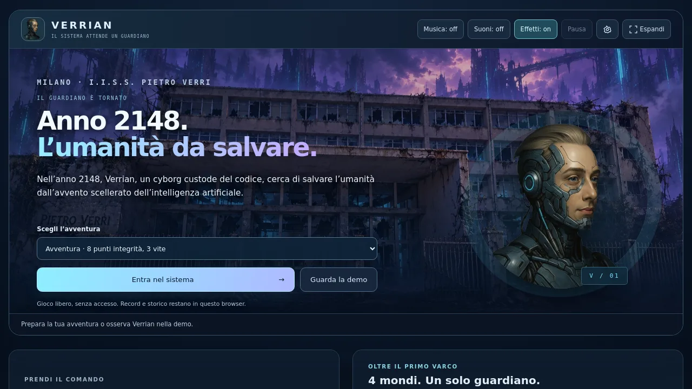 | 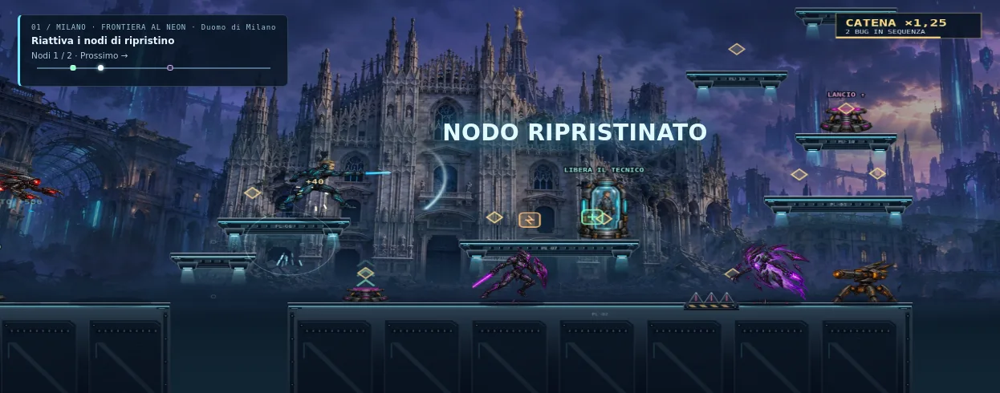 |
| **Schermata iniziale** · Milano, anno 2148 | **Mondo 1** · Frontiera al neon, Duomo di Milano |
| 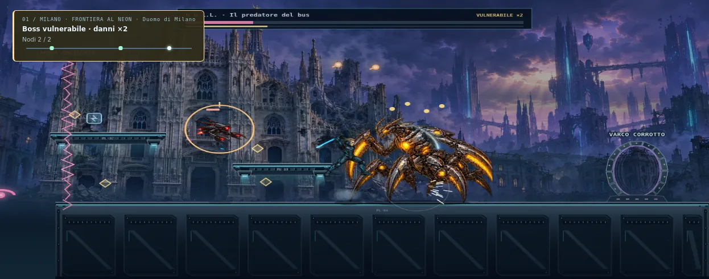 | 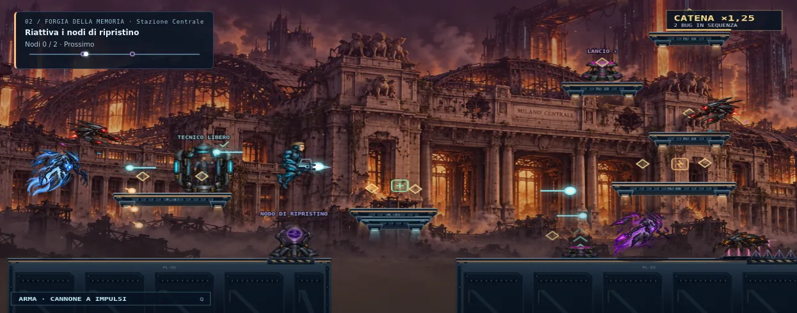 |
| **Primo boss** · N.U.L.L. | **Mondo 2** · Forgia della memoria, Stazione Centrale |
| 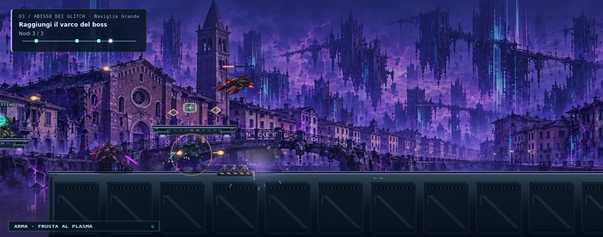 | 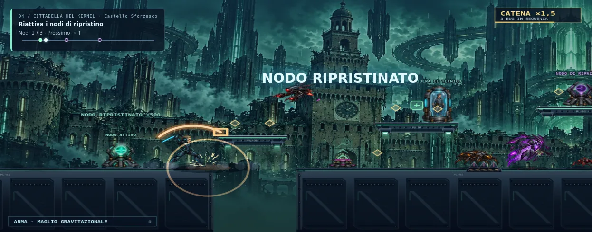 |
| **Mondo 3** · Abisso dei glitch, Naviglio Grande | **Mondo 4** · Cittadella del kernel, Castello Sforzesco |

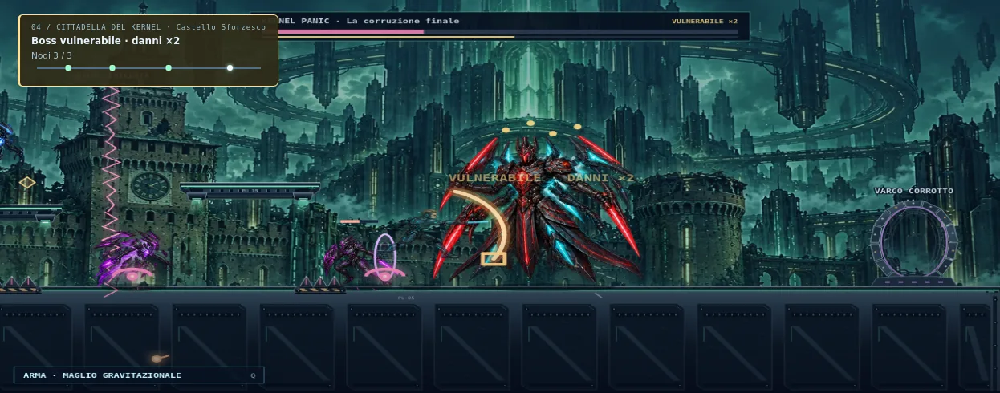

*Scontro finale con KERNEL PANIC.*

| | |
| --- | --- |
| 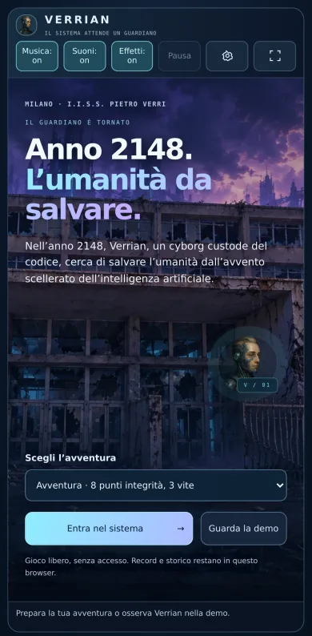 | 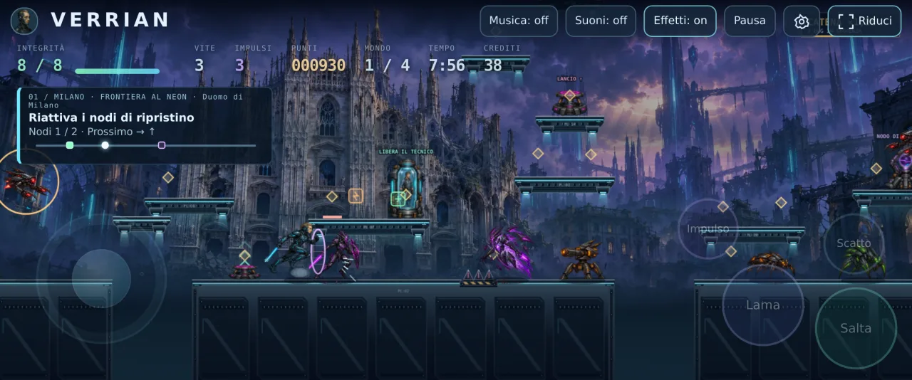 |
| **Smartphone in verticale** · schermata iniziale | **Smartphone in orizzontale** · schermo intero e gamepad virtuale semitrasparente |

## Caratteristiche

- Motore deterministico a 30 tick al secondo (`assets/verrian/core.js`): la stessa sequenza di comandi produce sempre la stessa partita, quindi ogni partita si può riprodurre e verificare.
- Grafica con WebGL (PixiJS 8) quando c’è una GPU, altrimenti Canvas 2D; schermo intero anche in 21:9.
- Combattimento con lama, armi a distanza, scatto, impulso, colpi da accovacciati e parate.
- Officina fra un mondo e l’altro: armi, armature, vitalità e mezzi (aliante, jetpack, moto).
- Ambientazione «Milano 2148»: Duomo, Stazione Centrale, Naviglio Grande e Castello Sforzesco in rovina; dalle impostazioni si possono scegliere invece gli sfondi originali «Mondi digitali».
- Piattaforme, punte, laser e barriere illustrati (`assets/verrian/terrain-art.js`), uguali nei due renderer.
- Musica originale «Custodi del 2148», suonata in tempo reale con Web Audio, e effetti sonori; musica e suoni si accendono e spengono separatamente.
- Impostazioni di ambientazione, qualità grafica, volume, scuotimento, lampi e aiuti; tasti personalizzabili e controller standard.
- Schermata iniziale ambientata nel 2148 davanti all’I.I.S.S. Pietro Verri in rovina, con racconto a scrittura progressiva.
- Tutorial contestuale, mappa dei nodi e traguardi locali.
- Cannone con mira diagonale: R o F insieme allo sparo; su touch i pulsanti Mira su e Mira giù.
- Porte segrete, torri e percorsi in verticale.
- Nessun account e nessun server: record, storico, preferenze e partita in corso (ripresa con Riprendi) restano nel browser (`localStorage`).

## Comandi

| Tasto | Azione |
| --- | --- |
| ← → / A D | Muoversi |
| Spazio / ↑ W | Salto (doppio salto in aria) |
| S / ↓ | Accovacciarsi |
| J / X | Attacco |
| K / Maiusc | Scatto |
| L / C | Impulso |
| Q / E | Cambio arma |
| ↓ + Q | Salire o scendere dal mezzo |
| R / F (con il cannone) | Mirare in diagonale in alto / in basso |
| P / Esc | Pausa |

I tasti si possono cambiare dalle impostazioni; è supportato anche un controller standard. Su telefono e tablet compare un gamepad virtuale: joystick a sinistra e pulsanti rotondi a destra (Salta, Lama/Spara, Scatto, Impulso; Arma, Mezzo e Mira quando servono). In orizzontale è semitrasparente sopra il campo; la partita parte a schermo intero con musica e suoni accesi. Dalle impostazioni si può tornare alla barra di pulsanti classica.

## Avvio in locale

È un sito statico: basta un qualsiasi server web nella cartella del progetto.

```sh
python3 -m http.server 8000
# poi apri http://localhost:8000/
```

Parametri utili: `?renderer=canvas` o `?renderer=pixi` per forzare il motore grafico, `?fps=1` per vedere i fotogrammi al secondo.

## Test

Richiedono Node.js 18 o successivo, senza dipendenze.

```sh
npm test
```

- `tests/core.test.cjs`: regole di gioco, limiti, determinismo e una partita completa vincente (`tests/fixtures/verrian-win.json`).
- `tests/art.test.cjs`: pose, atlanti e ritagli delle immagini.
- `tests/local.test.cjs`: salvataggi locali, record e ripresa della partita.
- `tests/experience.test.cjs`: officina, controller, tasti personalizzati, tutorial e traguardi.

`tools/verify-replay.cjs` riproduce una partita a partire da seme, difficoltà e comandi (JSON su stdin) e stampa il risultato: è lo strumento con cui un server può verificare un punteggio.

## Struttura

```
index.html                 pagina del gioco (configurazione dei livelli inclusa)
assets/verrian/core.js     motore di gioco puro, condiviso da browser e Node
assets/verrian/game.js     interfaccia, comandi, salvataggi
assets/verrian/prologue.js     racconto della schermata iniziale
assets/verrian/experience.js   tutorial, traguardi e impostazioni
assets/verrian/local-state.js  record, storico e partita da riprendere
assets/verrian/audio.js        musica ed effetti sonori
assets/verrian/terrain-art.js  piattaforme e ostacoli illustrati
assets/verrian/graphics-loader.js  caricamento di immagini e PixiJS
assets/verrian/render.js   renderer Canvas 2D
assets/verrian/render-pixi.js  renderer WebGL (PixiJS)
assets/verrian/art.js      pose e ritagli degli atlanti grafici
assets/verrian/*.webp      fondali, personaggi, nemici, oggetti, officina
assets/verrian/og-verrian-v2.jpg  copertina per le anteprime social
assets/vendor/pixi-8.22.0  PixiJS (licenza MIT)
games/verrian/levels.json  livelli (stessa configurazione di index.html)
games/verrian/art-prompts.json  provenienza delle immagini
docs/screenshots/          immagini di questo README
```

## Crediti

- Gioco, codice e livelli: laboratorio di informatica dell’I.I.S.S. Pietro Verri, Milano.
- Immagini generate con strumenti di intelligenza artificiale a partire dal ritratto originale del personaggio; prompt e riferimenti sono in `games/verrian/art-prompts.json` e `assets/verrian/og-verrian-v1.json` (copertina con i testi corretti: `og-verrian-v2.json`). Le immagini in `docs/screenshots/` sono catture reali del gioco (renderer Canvas) durante la partita vincente dei test.
- Lo sfondo della schermata iniziale reinterpreta la sede dell’I.I.S.S. Pietro Verri di Milano; la fotografia usata come riferimento non è inclusa nel repository.
- Facciata del Duomo di riferimento: [Wikimedia Commons](https://commons.wikimedia.org/wiki/File:Milan-duomo-front-facade.jpg), CC0.
- [PixiJS](https://pixijs.com/) 8.22.0, licenza MIT (`assets/vendor/pixi-8.22.0/LICENSE`).

## Licenza

Codice, livelli e immagini del gioco sono distribuiti con licenza [MIT](LICENSE): si possono usare, modificare e ridistribuire liberamente, anche per scopi commerciali, mantenendo l’avviso di copyright. PixiJS resta soggetto alla propria licenza MIT (`assets/vendor/pixi-8.22.0/LICENSE`).
